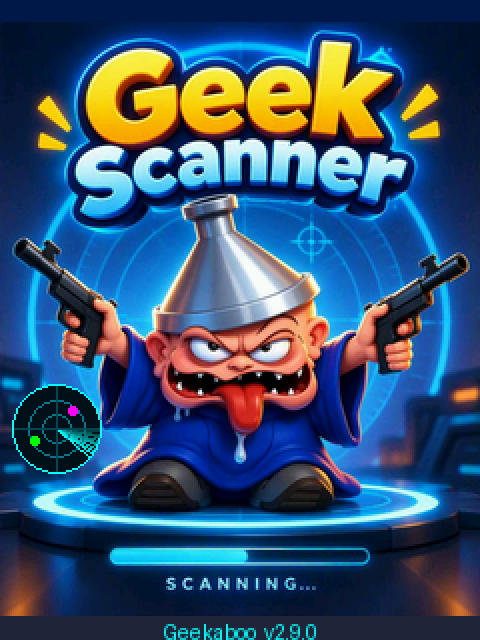

# Geekaboo Multi Scanner

A pocket radio scanner for the **ESP32 "Cheap Yellow Display"**, in 2.8" and 3.5" versions. It shows nearby Bluetooth devices, Wi-Fi networks, crowded Wi-Fi channels, Bluetooth trackers, and MeshCore radios on a touch screen.

<p align="center">
  
</p>

**Version:** 2.6.0 · **Author:** Geekaboo

---

## Contents

- [Features](#features)
- [Hardware](#hardware)
- [Install the firmware](#install-the-firmware)
- [Using the scanner](#using-the-scanner)
  - [Boot screen](#boot-screen)
  - [Screen layout](#screen-layout)
  - [BLE tab](#ble-tab)
  - [WIFI tab](#wifi-tab)
  - [CHAN tab](#chan-tab)
  - [TAGS tab](#tags-tab)
  - [MESH tab](#mesh-tab)
  - [Detail page and signal meter](#detail-page-and-signal-meter)
  - [Settings](#settings)
  - [Touch calibration](#touch-calibration)
  - [LED colours](#led-colours)
- [Troubleshooting](#troubleshooting)
- [Build from source](#build-from-source)
- [Change the boot image](#change-the-boot-image)
- [Host your own web installer](#host-your-own-web-installer)
- [Repository layout](#repository-layout)
- [Limitations](#limitations)
- [Changelog](#changelog)

---

## Features

| Tab | What it does |
|---|---|
| **BLE** | Lists nearby Bluetooth Low Energy devices, sorted by signal strength. Unnamed devices show their vendor (Apple, Samsung, Google, …). |
| **WIFI** | Lists 2.4 GHz Wi-Fi networks with name, channel, security type and BSSID. Open networks are marked in orange. |
| **CHAN** | A Wi-Fi channel analyzer. It draws each network as a curve over channels 1 to 13 and suggests the least crowded of channels 1, 6 and 11. |
| **TAGS** | Detects Bluetooth trackers: Apple Find My (AirTag), Samsung SmartTag, Tile and Google Find Hub. It warns when a tracker has stayed near you for a long time. |
| **MESH** | Finds MeshCore devices: companion radios advertising over Bluetooth, other Nordic UART devices, and MeshCore devices in Wi-Fi update mode. |

The firmware also has:

- **Signal meter:** tap any entry for a large live signal reading. Walk around to find where a device is.
- **Portrait or landscape:** one button rotates the screen in 90° steps, and the rotation is remembered after a restart.
- **Settings page:** filters, scan speed, tracker alert time, screen brightness and colour inversion, all saved to flash.
- **Touch calibration:** a short tap-the-crosses routine, so touch lines up on any panel.
- **Crash banner:** if the board ever restarts unexpectedly, the next boot shows the reason.

---

## Hardware

Three boards are supported. Each has its own firmware file.

| | **ESP32-2432S028** (2.8") | **ESP32-3248S035R** (3.5") | **ESP32-3248S035C** (3.5") |
|---|---|---|---|
| Firmware file | `…-cyd28.bin` | `…-cyd35r.bin` | `…-cyd35c.bin` |
| Screen | 240×320, ILI9341 | 320×480, ST7796 | 320×480, ST7796 |
| Touch | Resistive, XPT2046 on its own SPI bus (CLK 25, MOSI 32, MISO 39, CS 33, IRQ 36) | Resistive, XPT2046 sharing the display bus (CS 33) | **Capacitive**, GT911 on I2C (SDA 33, SCL 32, INT 21, RST 25) |
| Display pins | MISO 12, MOSI 13, SCK 14, CS 15, DC 2 | same | same |
| Backlight | pin 21 | pin 27 | pin 27 |
| Tested on hardware | **Yes** (2-USB version) | Not yet | Not yet |

All three have the RGB LED on pins 4 / 16 / 17 (lit when the pin is low).

**R or C?** Look at the back of the 3.5" board, or at the screen: the **C** (capacitive) version has a smooth glass front that reacts to a light touch, like a phone. The **R** (resistive) version has a slightly soft plastic surface that needs a firm press.

You also need a good USB cable and port, because Wi-Fi and Bluetooth together draw a lot of current. No soldering or extra parts are needed.

---

## Install the firmware

### Option 1: Web installer (easiest)

You need **Chrome or Edge on a desktop computer**. Safari and Firefox don't support Web Serial.

1. Connect the CYD with a USB **data** cable.
2. Open the project's installer page https://geekab00.github.io/Scanner/ or go to **[web.esphome.io](https://web.esphome.io)**.
3. Click **Connect** (or **FLASH FIRMWARE**) and pick the serial port. It's usually called *CH340* or *CP210x*.
4. On the installer page, pick your board first. On web.esphome.io, choose **Install** and select the file for your board from `firmware/` (see [Hardware](#hardware)).
5. When it's done, press **RST** on the board.

If the browser can't connect, hold **BOOT**, tap **RST**, release **BOOT**, then try again.

### Option 2: esptool (command line)

```bash
pip install esptool
esptool --chip esp32 --port /dev/ttyUSB0 --baud 921600 write-flash 0x0 firmware/geekaboo-scanner-v2.6.0-cyd28.bin
```

Use the file for your board (`-cyd28`, `-cyd35r` or `-cyd35c`). On Windows the port looks like `COM5`. On macOS it's `/dev/cu.usbserial-…`. Older esptool versions use `esptool.py` and `write_flash`.

The `.bin` is a **merged image** (bootloader, partition table and app in one file), so it always goes to address **0x0**.

### Option 3: Arduino IDE

See [Build from source](#build-from-source).

---

## Using the scanner

### Boot screen

After power-on the Geek Scanner image appears, with the version number at the bottom. Wi-Fi and Bluetooth start in the background while it's showing. The RGB LED pulses magenta while it waits.

**Tap the screen to start.** That first tap only dismisses the image, so it never presses a button underneath.

- **3.5" boards:** on the very first start, [touch calibration](#touch-calibration) runs straight after this tap.
- **Hold your finger on the boot screen for 3 seconds** to run touch calibration on any board. A magenta bar says *release to calibrate touch*.

If a red line appears at the top of the boot screen, the previous restart was unexpected. See [Troubleshooting](#troubleshooting).

### Screen layout

```
┌──────────────────────────────┐
│ Geekaboo v2.5.0     12 dev ● │  header: name, version, count, scan dot
├─────┬─────┬─────┬─────┬──────┤
│ BLE │WIFI │CHAN │TAGS │ MESH │  tabs
├─────┴─────┴─────┴─────┴──────┤
│ Device name        ▇▇▇▇▁ -58 │
│ aa:bb:cc:dd:ee:ff            │  list rows (tap for details)
│ …                            │
├──────┬──────┬──────┬──────┬──┤
│  ▲   │  ❚❚  │  ⟳   │  ⚙   │▼ │  footer
└──────┴──────┴──────┴──────┴──┘
```

**Header**
- Left: **Geekaboo** and the firmware version.
- Right: the number of items in the current tab, or **PAUSED**.
- The dot on the far right is lit while a scan is running: cyan for Bluetooth, green for Wi-Fi.

**Footer buttons**

| Button | Action |
|---|---|
| ▲ | Scroll up one page |
| ❚❚ / ▶ | Pause or resume scanning. While paused the list order is frozen, which makes it easier to tap an entry. |
| ⟳ | Rotate the screen 90°. The setting is remembered. |
| ⚙ | Open [Settings](#settings) |
| ▼ | Scroll down one page |

**Signal colours**

| Colour | Signal |
|---|---|
| Green | Stronger than −60 dBm (close) |
| Yellow | −60 to −80 dBm |
| Red | Weaker than −80 dBm (far away) |
| Grey | Not heard for 10 seconds (stale) |

Entries that haven't been heard for the time set in **Forget after** (default 1 minute) disappear from the list.

### BLE tab

All Bluetooth Low Energy devices nearby, strongest first.

- **Top line:** the device name. If the device sends no name, it shows the vendor from its manufacturer data (for example `<Apple>`), or `<unnamed>`.
- **Bottom line:** the MAC address. Trackers are marked **TAG** in orange.
- **Right side:** a signal bar and the signal strength in dBm.

The list holds up to 64 devices. When it's full, the device heard longest ago is replaced.

### WIFI tab

All 2.4 GHz Wi-Fi networks nearby, strongest first.

- **Top line:** the network name (SSID), or `<hidden>`.
- **Bottom line:** channel, security type and BSSID. Open networks (no password) are shown in orange.

Security types: `OPEN`, `WEP`, `WPA`, `WPA2`, `WPA/2`, `WPA2-E` (enterprise), `WPA3`, `WPA2/3`.

The list holds up to 48 networks. The ESP32 only has a 2.4 GHz radio, so 5 GHz and 6 GHz networks don't appear.

### CHAN tab

A channel graph of the Wi-Fi networks from the WIFI scan.

- Each network is drawn as a curve centred on its channel. The height of the curve is its signal strength.
- The five strongest networks are labelled with their name.
- Channels 1, 6 and 11 are highlighted, because these are the channels that don't overlap.
- **best channel:** of 1, 6 and 11, the one with the least nearby traffic. It's a good pick for your own router or access point.

### TAGS tab

Bluetooth trackers nearby:

| Tracker | How it's recognised |
|---|---|
| Apple Find My (AirTag and other Find My devices) | Apple manufacturer data, type 0x12 |
| Samsung SmartTag | Service 0xFD5A |
| Tile | Service 0xFEED / 0xFEEC |
| Google Find Hub | Eddystone service 0xFEAA, frame type 0x40/0x41 |

Each row shows the tracker type, the MAC address, and **how long it has been near you**.

- When a new tracker is detected, the LED flashes red.
- When a tracker has been nearby longer than the **Tracker alert** time (default 10 minutes), its row turns **magenta**.

> **About the timer:** most trackers change their Bluetooth address regularly for privacy. When that happens the scanner sees a "new" device and the timer starts again. Treat the time as an indication, not proof. If you think you're being tracked, use the official tools as well: *Find My* on iPhone, *Unknown tracker alerts* on Android, or the SmartThings and Tile apps.

### MESH tab

[MeshCore](https://github.com/meshcore-dev/MeshCore) devices that can be seen over Bluetooth or Wi-Fi:

| Shown as | Meaning |
|---|---|
| **Node name** in magenta, `companion` | A MeshCore companion radio advertising as `MeshCore-<node name>`. Only the node name is shown. |
| `<name>` or `<NUS device>`, `UART?` | A device with the Nordic UART service. MeshCore uses this service, but so do many other gadgets, so treat these as *possible* matches. |
| `MeshCore-…` in orange, `Wi-Fi OTA` | A MeshCore device in Wi-Fi update mode (its `MeshCore-OTA` access point). |

Companions come first, then UART devices, then Wi-Fi entries. In this tab the scanner mostly scans Bluetooth, with a Wi-Fi scan every 4th round to catch OTA access points.

> A companion radio **stops advertising while your phone app is connected to it**. Disconnect the app to see it here. The CYD has no LoRa radio, so it can't hear the mesh itself; see [Limitations](#limitations).

### Detail page and signal meter

Tap any row in the BLE, WIFI, TAGS or MESH tab to open its detail page.

- **Top:** a large signal reading in dBm with a full-width bar. It updates twice a second. It shows **LOST** when the device hasn't been heard for 10 seconds.
- **Bluetooth devices:** MAC, name, tracker type, MeshCore type, vendor (company ID), TX power, service UUID, how often and how long ago it was seen, how long it has been nearby, and raw manufacturer data.
- **Wi-Fi networks:** SSID, BSSID, channel, security, how often and how long ago it was seen, and how long it has been known.

**Finding a device:** open its detail page and walk around slowly. The number goes up (towards −30) as you get closer. Bluetooth signal strength jumps around a lot, so pause for a few seconds at each spot. Your body also blocks the signal, so turn around slowly too.

Tap anywhere to go back to the list.

### Settings

Tap ⚙ in the footer. Tap a setting to step to its next value. Changes are saved right away and survive a restart.

| Setting | Values | Default | What it does |
|---|---|---|---|
| Min signal | off, −90, −80, −70 dBm | off | Hides devices and networks weaker than this |
| Hide stale | off, on | off | Hides entries not heard for 10 seconds instead of greying them out |
| Scan time | 2, 3, 5 s | 3 s | Length of one Bluetooth scan pass. Longer passes find more devices but update more slowly. |
| Forget after | 30 s, 1 min, 5 min | 1 min | Removes entries not heard for this long |
| Tracker alert | 5, 10, 20, 30 min | 10 min | A tracker nearby longer than this turns magenta |
| Brightness | 25, 50, 75, 100 % | 100 % | Screen backlight |
| Invert colours | off, on | off | Flips the panel's colour mode. Turn on if black looks white and colours look like a negative. |
| Calibrate touch | start | | Runs [touch calibration](#touch-calibration) |
| Reset to defaults | | | Puts all settings back to the defaults above (touch calibration is kept) |

Tap **BACK** at the bottom to return to the scanner.

### Touch calibration

Calibration lines up the touch panel with the screen. It runs by itself on the first start of a **3.5"** board. On any board you can run it from **Settings → Calibrate touch**, or by holding a finger on the boot screen for 3 seconds.

1. A cyan cross appears in the **top-left** corner. Tap its centre, ideally with a fingernail or stylus.
2. Do the same for the crosses in the **top-right** and **bottom-left** corners.
3. A green **check** cross appears bottom-right. Tap it.
   - If the tap lands within about 30 pixels, you see **saved** and the scanner continues.
   - If not, it says *not accurate enough* and starts again.

The result is saved to flash and kept after restarts and setting resets. It works out by itself whether the panel's axes are swapped or mirrored, so it fixes "touch is upside down or sideways" as well as small offsets. If nobody touches the screen for 60 seconds, calibration stops and keeps the previous values.

The 2.8" board works out of the box with built-in values, so it doesn't ask for calibration.

### LED colours

| LED | Meaning |
|---|---|
| Pulsing magenta | Boot screen, waiting for a tap |
| Magenta | Touch calibration running |
| Blue | Bluetooth scan running |
| Green | Wi-Fi scan running |
| Short red flash | New tracker detected |

---

## Troubleshooting

### The boot screen keeps blinking / the board restarts by itself

The board is restarting in a loop. Look at the **red line at the top of the boot screen**:

| Red line says | Cause | What to do |
|---|---|---|
| `POWER DIP (brownout)` | The USB supply can't deliver enough current when the radios start | Use a short, good-quality data cable and a USB port directly on the computer or a powered hub, or a 5 V / 1 A+ phone charger |
| `CRASH at bluetooth` / `CRASH at wi-fi` | A radio failed to start | Reflash with **Erase device** ticked (web installer) or run `esptool erase-flash` first, then flash again |
| `WATCHDOG at …` | The firmware froze | Same as above; if it keeps happening, open an issue with the full red line |

Serial output at **115200 baud** shows every boot step with the free memory, for example `[boot] bluetooth  free heap …`.

### Nothing happens when I tap the boot screen

- On the 2.8" and 3.5" **R** boards, tap firmly; the panel is resistive and needs pressure, not a light swipe. A fingernail or stylus works best.
- On the 3.5" **C** board, check the serial output at 115200 baud for `[touch] GT911 found`. If it says `NOT found`, the touch chip didn't answer; power the board off and on again.
- If the screen redraws by itself every few seconds, it's restarting. See the previous section.

### Touches land in the wrong place

Run [touch calibration](#touch-calibration): hold a finger on the boot screen for 3 seconds, or use **Settings → Calibrate touch** if you can still reach it. The serial output shows the raw values and the result (`[cal] …`), which helps when reporting a problem.

### Display looks wrong or garbled

**Colours look like a negative** (black shows as white): turn on **Settings → Invert colours**. No rebuild needed.

**Picture is garbled or the screen stays white:** make sure you flashed the file for your board (`-cyd28`, `-cyd35r` or `-cyd35c`).

The 2.8" board ships with different display panels. The release build uses the ILI9341 driver with inverted colours, which matches most **2-USB** boards. If yours is still garbled, build from source with one of these settings in `User_Setups/CYD28_User_Setup.h`:

| Variant | Setting in `User_Setup.h` | Try when |
|---|---|---|
| **A** (release) | `ILI9341_2_DRIVER`, `TFT_INVERSION_ON`, 40 MHz | Default, most 2-USB boards |
| B | `ST7789_DRIVER`, `TFT_INVERSION_OFF`, `TFT_RGB_ORDER TFT_BGR`, 27 MHz | 2-USB board with ST7789 panel |
| C | `ILI9341_DRIVER`, `TFT_INVERSION_ON`, 27 MHz | A is garbled |
| D | `ILI9341_2_DRIVER`, `TFT_INVERSION_OFF`, 40 MHz | Colours look like a negative (single-USB boards) |

### The browser can't find the board

- Use Chrome or Edge on a desktop. Phones and Safari can't do Web Serial.
- Some USB cables only carry power. Try another cable.
- Install the USB driver for the chip on your board: **CH340** or **CP210x**.
- Use the BOOT + RST trick from [Install the firmware](#install-the-firmware).

---

## Build from source

### Requirements

| Item | Version used |
|---|---|
| Arduino IDE 2.x or `arduino-cli` | arduino-cli 1.3.1 |
| ESP32 board package (Espressif) | **3.3.2** |
| [TFT_eSPI](https://github.com/Bodmer/TFT_eSPI) by Bodmer | 2.5.44 |
| [XPT2046_Touchscreen](https://github.com/PaulStoffregen/XPT2046_Touchscreen) by Paul Stoffregen (2.8" board only) | 1.4 |

### Choose the board

The sketch picks the board from the display config file **`User_Setup.h` in the sketch folder** (`src/Geekaboo_Scanner/`). The repository ships with the 2.8" config. For another board, copy its file over it:

| Board | Copy this file to `src/Geekaboo_Scanner/User_Setup.h` |
|---|---|
| ESP32-2432S028 (2.8") | `User_Setups/CYD28_User_Setup.h` (already in place) |
| ESP32-3248S035R (3.5" resistive) | `User_Setups/CYD35R_User_Setup.h` |
| ESP32-3248S035C (3.5" capacitive) | `User_Setups/CYD35C_User_Setup.h` |

The `User_Setup.h` in the sketch folder takes priority over the one inside the TFT_eSPI library folder, so you don't need to touch the library. If the file doesn't match a known board, the build stops with an error that says what to copy.

### Steps (Arduino IDE)

1. Install the **esp32** board package by Espressif Systems: *Tools → Board → Boards Manager*.
2. Install **TFT_eSPI** and **XPT2046_Touchscreen**: *Tools → Manage Libraries*.
3. [Choose the board](#choose-the-board) by copying its `User_Setup.h` into the sketch folder.
4. Open `src/Geekaboo_Scanner/Geekaboo_Scanner.ino`.
5. Select:
   - **Board:** `ESP32 Dev Module`
   - **Partition Scheme:** `Huge APP (3MB No OTA/1MB SPIFFS)`. This is **required**: the firmware is about 1.8 to 2 MB and doesn't fit the default partition.
6. Click **Upload**.

### Steps (arduino-cli)

```bash
arduino-cli core install esp32:esp32@3.3.2
arduino-cli lib install "TFT_eSPI" "XPT2046_Touchscreen"
# pick the board (here: 3.5" resistive)
cp src/Geekaboo_Scanner/User_Setups/CYD35R_User_Setup.h src/Geekaboo_Scanner/User_Setup.h

arduino-cli compile -b esp32:esp32:esp32:PartitionScheme=huge_app \
  --output-dir build --export-binaries src/Geekaboo_Scanner
arduino-cli upload -b esp32:esp32:esp32:PartitionScheme=huge_app \
  -p /dev/ttyUSB0 --input-dir build src/Geekaboo_Scanner
```

### Make a merged image for the web installer

```bash
esptool --chip esp32 merge-bin -o firmware/geekaboo-scanner-vX.Y.Z.bin \
  --flash-mode dio --flash-freq 80m --flash-size 4MB \
  0x1000  build/Geekaboo_Scanner.ino.bootloader.bin \
  0x8000  build/Geekaboo_Scanner.ino.partitions.bin \
  0xe000  ~/.arduino15/packages/esp32/hardware/esp32/3.3.2/tools/partitions/boot_app0.bin \
  0x10000 build/Geekaboo_Scanner.ino.bin
```

Then update the file name and `"version"` in `manifest.json`.

### Change the version number

The version is defined once, near the top of the sketch:

```cpp
#define FW_VERSION "2.6.0"
```

The boot screen, the header and the serial output all use it.

### Useful constants

| Constant | Default | Meaning |
|---|---|---|
| `STALE_MS` | 10000 | After this many ms an entry is greyed out or shown as LOST |
| `MAX_DEVS` | 64 | Maximum Bluetooth devices kept in memory |
| `MAX_APS` | 48 | Maximum Wi-Fi networks kept in memory |
| `OPT_*` arrays | | The values the Settings page cycles through |

---

## Change the boot image

1. Pick a picture. Portrait works best; it's scaled to fit the screen without cropping, and the empty space is filled with the colour of the picture's edge.
2. Convert it, once per screen size:
   ```bash
   pip install pillow
   # 2.8" board, 240x320
   python3 tools/make_splash.py my_picture.jpg src/Geekaboo_Scanner/splash_image.h
   # 3.5" boards, 320x480
   python3 tools/make_splash.py my_picture.jpg src/Geekaboo_Scanner/splash_image_35.h 320x480
   ```
3. Build and flash again.

The boot image is drawn **upside down** compared with the default portrait orientation (`tft.setRotation(2)` in `setup()`). Change it to `0` to show it the other way round. The image takes about 150 KB of flash on the 2.8" board and 300 KB on the 3.5" boards.

---

## Host your own web installer

The installer is a static page using [ESP Web Tools](https://esphome.github.io/esp-web-tools/), so it runs on **GitHub Pages**:

1. Push this repository to GitHub.
2. Go to *Settings → Pages* and set the source to **Deploy from a branch**, branch `main`, folder `/ (root)`.
3. After a minute the installer is live at `https://<your-user>.github.io/<repo-name>/`.

Web Serial only works over **HTTPS**. GitHub Pages provides that; opening `index.html` from your own disk won't work.

The page has a board picker; each board has its own manifest (`manifest-cyd28.json`, `manifest-cyd35r.json`, `manifest-cyd35c.json`). To publish a new version, put the new `.bin` files in `firmware/`, then update the file names and versions in the three manifests and the version in `index.html`.

---

## Repository layout

```
.
├── README.md                     this manual
├── index.html                    web installer page with board picker (ESP Web Tools)
├── manifest-cyd28.json           which .bin to flash, per board
├── manifest-cyd35r.json
├── manifest-cyd35c.json
├── .nojekyll                     serve files as-is on GitHub Pages
├── firmware/                     merged images, flash at 0x0
│   ├── geekaboo-scanner-v2.6.0-cyd28.bin
│   ├── geekaboo-scanner-v2.6.0-cyd35r.bin
│   └── geekaboo-scanner-v2.6.0-cyd35c.bin
├── src/
│   └── Geekaboo_Scanner/
│       ├── Geekaboo_Scanner.ino  the firmware (all boards)
│       ├── User_Setup.h          display config that picks the board (2.8" by default)
│       ├── User_Setups/          display configs for each board
│       ├── splash_image.h        boot image, 240×320
│       └── splash_image_35.h     boot image, 320×480
├── tools/
│   └── make_splash.py            convert a picture into a boot image
└── docs/
    └── splash.png                boot screen preview for this README
```

---

## Limitations

- **2.4 GHz only.** The ESP32 can't see 5 GHz or 6 GHz Wi-Fi.
- **One radio for both.** Bluetooth and Wi-Fi share one antenna, so the scanner switches between them. In the WIFI and CHAN tabs it only scans Wi-Fi; in BLE and TAGS it only scans Bluetooth.
- **No LoRa.** The MESH tab finds MeshCore devices through Bluetooth and Wi-Fi only. It can't hear mesh packets, repeaters or adverts on 869 MHz.
- **No Bluetooth Classic.** Older devices that only use Classic Bluetooth (some headsets, car kits) don't appear.
- **Rotating addresses.** Phones and trackers change their Bluetooth address for privacy, so one physical device can appear as several entries over time.
- **Signal ≠ distance.** dBm gives a rough idea of distance, but walls, bodies and antenna direction have a big effect.

---

## Changelog

| Version | Changes |
|---|---|
| **2.6.0** | Support for the 3.5" ESP32-3248S035R and ESP32-3248S035C. Touch calibration (first start on 3.5", Settings, or 3-second hold on the boot screen). *Invert colours* setting. Board picker on the installer page. |
| 2.5.0 | Version shown on the boot screen. Removed the MeshCore companion connection to save memory. TAGS tab back. |
| 2.4.0 | TAGS tab removed (test build). |
| 2.3.1 | Fixed a restart loop at boot (memory). Boot image flipped 180°. Crash banner on the boot screen. |
| 2.3.0 | Settings page. MeshCore companion connection. |
| 2.2.0 | MESH tab. |
| 2.1.0 | Boot image that waits for a tap; version in the header. |
| 2.0.0 | Portrait mode, rotate button, WIFI, CHAN and TAGS tabs, detail page with signal meter. Fixed oversized text. |
| 1.0.0 | First version: Bluetooth scanner. |

---

<p align="center">Made by <b>Geekaboo</b></p>
